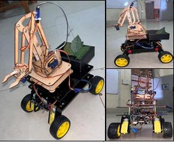
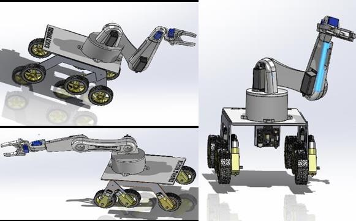
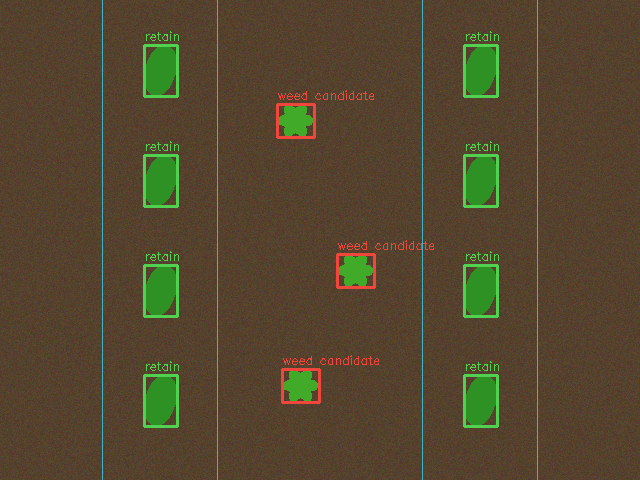
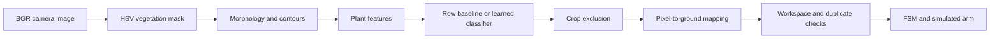
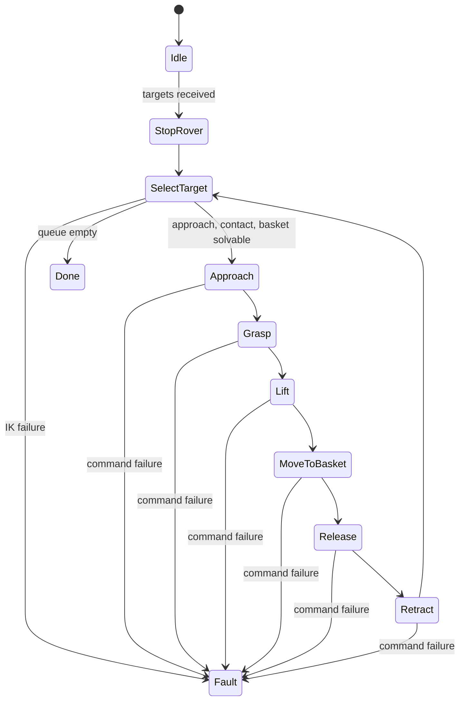

# Krishak Robot

**Agricultural mobile manipulation · Computer vision · Robotics control**

Krishak Robot is an agricultural mobile manipulator designed for **herbicide-free weed management**. The idea is to recognize weeds with an onboard camera, locate them relative to the arm, and use a gripper to uproot and collect them. A finite state machine coordinates perception, rover movement, and manipulation.

This repository focuses on that perception-to-action loop. It includes a runnable vision pipeline, a trainable plant classifier, arm kinematics, and a simulated robot controller. A small generated field scene makes the complete workflow easy to inspect without a camera or robot.

The project paper documents **Krishak Robot–SEED**, an initial four-wheel differential-drive prototype with a four-DOF arm. It presents a six-wheel rocker-bogie rover with a six-DOF arm as the intended final platform. For weeding, the paper uses three revolute positioning joints and a gripper; the additional arm DOFs are reserved for future tasks.



*Initial prototype, reproduced from Figure 1 of the supplied paper, page 3.*



*Proposed six-wheel platform with six-DOF arm, Figure 2a, page 3. This is a design rendering, not a photograph of a completed six-wheel robot.*

This repository is a new software implementation informed by the project paper, not recovered firmware. See the [paper notes](docs/paper-notes.md) for technical context and figure credits; the manuscript itself is not distributed here. The code includes the paper-inspired reduced arm model and a separate six-joint simulation. Original source code, trained camera data, measured arm dimensions, and field-test records were not supplied.

## Hardware and perception architecture

| Subsystem | Described in the paper | Available in this repository |
| --- | --- | --- |
| Mobile platform | Four-wheel SEED prototype; proposed six-wheel differential-drive rocker-bogie | Six-wheel command simulator; no terrain model |
| Plant perception | Arm-mounted HuskyLens with onboard ML; coordinates sent to Arduino over serial | OpenCV baseline and optional logistic classifier; no HuskyLens driver |
| Manipulation | Three positioning joints plus gripper for uprooting and basket collection | Analytic reduced-arm IK, six-joint numerical IK, simulated grasp/lift/deposit |
| Navigation | AprilTag localization, encoders, AHRS heading feedback | Integration design only; no autonomous navigation implementation |
| Computing | Raspberry Pi main processor and Arduino Uno for low-level control | Desktop Python modules with a simulated robot adapter |
| Coordination | FSM with detection, crop handling, movement, and uprooting | Stationary perception-to-manipulation FSM with fault handling |

The paper lists MDD3A and L293D motor-control hardware, SG90 micro servos, an acrylic arm structure, 300 rpm BO motors, and 65 mm wheels. It also names IR/proximity sensors, encoders, and an AHRS. The component list does not clearly assign every item to the SEED prototype or final platform. See [paper notes and figure credits](docs/paper-notes.md) for page references and unresolved details.

## Run the project

Use Python 3.10 or newer. From this folder:

```sh
python3 -m venv .venv
source .venv/bin/activate
python -m pip install .
krishak demo
krishak demo --arm seed --output outputs/seed
python -m unittest discover -s tests -v
```

On Windows, activate with `.venv\Scripts\activate`. OpenCV runs headlessly, so no desktop window or camera is needed.

After editing the source, run `python -m pip install .` again to refresh the installed CLI.

The demo generates eight crop plants and three weeds, processes the image, and attempts three simulated uproot-and-deposit sequences. A successful run prints `11` plants, `3` weed candidates, and state `done`. The `seed` option selects the reduced positioning arm plus gripper; the rover simulator remains six-wheeled. This checks the integration on a deliberately simple fixture; it is not a weed-detection accuracy benchmark.



*Generated demo scene: green boxes mark retained plants; red boxes mark weed candidates.*

| Output | What to inspect |
| --- | --- |
| `outputs/demo/input.png` | Generated overhead field image |
| `outputs/demo/mask.png` | Vegetation segmentation mask |
| `outputs/demo/detections.png` | Plant boxes and crop exclusion bands |
| `outputs/demo/features.csv` | Per-plant features with blank labels for annotation |
| `outputs/demo/run.json` | Candidate count, simulated actions, state transitions, and errors |

## Computer vision pipeline



The first stage thresholds green vegetation in HSV space and removes small isolated regions with morphological opening. Connected contours become plant proposals. Each proposal has four features: image-area fraction, bounding-box aspect ratio, contour fill ratio, and distance to the nearest crop row.

This desktop pipeline provides a way to inspect and evaluate perception independently of hardware. The paper's perception device is **HuskyLens**, which performs recognition onboard and communicates detections to the Arduino. Its model architecture, training set, class configuration, and pixel-to-arm calibration are not specified. The OpenCV and logistic-regression implementations here are repository choices, not descriptions of the HuskyLens internals.

The default detector marks vegetation outside configured crop bands as weed candidates. This is an interpretable baseline for an overhead view of straight crop rows. It cannot distinguish crop and weed species, detect weeds inside a crop band, or reliably separate overlapping leaves. Shadows, brown vegetation, green objects, and perspective changes can also break its assumptions.

An optional **logistic regression classifier** learns from labeled plant features. It uses standardized inputs, binary cross-entropy optimization, and L2 regularization. The classifier produces a weed score; crop-band exclusion still applies afterward. No pretrained weights or field dataset are bundled, and model scores are not calibrated confidence estimates.

### Process your own image

```sh
krishak demo --image path/to/field.jpg --rows 0.25 0.75 --crop-band 0.09 --output outputs/field
```

Rows are horizontal image coordinates divided by image width; `crop-band` is the half-width of each protected band in the same units. The defaults assume two vertical crop rows. Check the mask and overlay before interpreting candidate locations.

External images run perception only unless you provide `--calibration path/to/homography.json`. The calibration is a JSON 3×3 matrix mapping image pixels to ground-plane metres in the arm-base frame. The synthetic demo supplies its own illustrative matrix. See [camera and robot integration](docs/integration.md) for the coordinate convention and calibration procedure.

### Train and evaluate the classifier

Run perception on your images to export `features.csv`. Use the `id`, `u`, and `v` columns to match each proposal to the original image, then label each proposal `0` for crop or `1` for weed. Combine labeled rows into training and test CSVs with the same header. A header template is included in `data/labels-template.csv`.

```sh
krishak train data/train.csv outputs/plant-model.json
krishak evaluate data/test.csv outputs/plant-model.json
krishak demo --image path/to/field.jpg --model outputs/plant-model.json --output outputs/classified
```

Supply your own `train.csv` and `test.csv`; both are intentionally absent. Split by field or capture session before assembling the CSVs so neighboring plants from near-identical images do not leak across the split. Training requires both classes. Evaluation reports the confusion matrix, precision, recall, and accuracy on the supplied rows. These measure the classifier on already extracted proposals, not missed plants, bounding-box quality, or the crop-filtered end-to-end pipeline. See the [evaluation plan](docs/evaluation.md).

## Robotics and task coordination

The rover simulator exposes linear and angular velocity commands and converts them to six wheel speeds using an illustrative skid-steer layout. It does not implement localization, obstacle avoidance, terrain dynamics, or autonomous navigation.

The default arm uses a six-joint standard Denavit–Hartenberg chain. Forward kinematics returns the tool transform. Numerical inverse kinematics uses a damped least-squares Jacobian to reach a Cartesian position within a 2 mm numerical tolerance. Tool orientation is unconstrained.

The `--arm seed` model follows the paper's base-yaw, shoulder, and elbow geometry. It solves position analytically using `atan2` and the law of cosines, checks reachability, and selects the valid elbow branch nearest the current pose. Gripper opening/closing is the fourth controlled DOF. Link lengths, ±π joint limits, track width, wheel radius, and basket position remain example parameters in `robotics.py` and `controller.py`, not measured hardware specifications.



An emergency-stop input takes any state to a latched fault. The controller stops the rover before arm movement, rejects points outside a defined working patch, and merges targets within 25 mm in the same observation. It solves the approach, target, and basket poses before moving. The gripper closes at the target, the arm lifts, moves to the basket, releases, and returns home. Fault recovery requires a new controller instance.

The action log records a **simulated uproot-and-deposit sequence**. There is no soil, root-force, grip-success, or removal-success model. Arm movements are instantaneous pose changes; there is no trajectory interpolation, collision checking, actuator feedback, or physical emergency-stop circuit. Deduplication applies to one image only. A moving robot needs synchronized stationary captures, stale-observation rejection, and persistent target tracking.

The original paper's FSM also handles crop spacing and forward travel. Those navigation states are not reproduced by this stationary task controller. The [paper notes](docs/paper-notes.md) include the original diagram and explain the relationship.

## Project structure

```text
src/krishak/
  vision.py         Segmentation, features, logistic classifier, overlays
  robotics.py       Ground mapping, reduced-arm and six-DOF FK/IK, rover
  controller.py     Task states, target checks, fault handling
  cli.py            Demo, feature export, training, evaluation
tests/
  test_pipeline.py  Perception, geometry, scheduling, and failure-path tests
docs/
  integration.md   Frames, calibration, and hardware interface boundaries
  evaluation.md    Dataset and measurement plan
  paper-notes.md   Paper architecture, prototype distinction, figure credits
  paper/           Extracted original figures; manuscript not included
data/
  labels-template.csv
```

## Reported project results

The supplied CV reports these figures. They are not established by the accompanying paper, which describes the design and prototype but provides no reproducible evaluation for these percentages.

| Metric | CV-reported result |
| --- | ---: |
| Agricultural task precision | 30% improvement |
| Labor costs | 20% reduction |
| FSM scheduling efficiency | 40% improvement |
| Weed-detection accuracy | 95% |
| Herbicide usage | 25% reduction |

These figures are not measurements from this implementation. The paper's primary approach is mechanical, herbicide-free uprooting; the CV's 25% herbicide reduction should not be interpreted as a measured spraying result or a verified outcome of this mechanism. The numerical IK tolerance is also not a claim about physical positioning accuracy.

## Next engineering steps

- Collect and label field images across lighting, growth stages, and soil conditions.
- Compare the row baseline and learned classifier; consider instance segmentation when plants overlap.
- Calibrate the camera against the arm frame and quantify target-location error.
- Replace example geometry with measured dimensions and add tool-orientation constraints and collision-aware trajectories.
- Implement actuator drivers, feedback, timeouts, and hardware interlocks before robot trials.
- Engineer and validate the gripper's contact geometry and extraction force, then test uprooting success and crop damage against a measured baseline.

## Project paper

*Krishak Robot: An Autonomous Ground Vehicle for Herbicide-Free Weed Management*, supplied manuscript by **Aklant Sahu, Aathira Gopinathan, Prashant Upadhyay, and Aryaveer Krishna**, K J Somaiya Institute of Technology. The supplied PDF does not establish a publication venue or date. Original figures retain their manuscript attribution; the generated field overlay is a separate software-demo artifact.

The most useful result here is a traceable path from an image detection to a robot task. Field performance remains something to measure.
