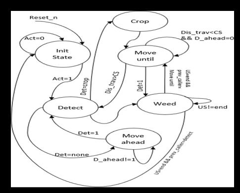
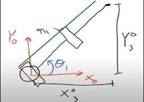
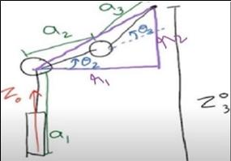

# Project paper and implementation notes

Source: *Krishak Robot: An Autonomous Ground Vehicle for Herbicide-Free Weed Management*, supplied privately as `PAPER.pdf`. Authors: Aklant Sahu, Aathira Gopinathan, Prashant Upadhyay, and Aryaveer Krishna, K J Somaiya Institute of Technology. Page numbers below refer to the eight-page PDF, which is not distributed in this repository. No venue, publication date, or DOI for this manuscript is established by the supplied file.

## Prototype versus intended platform

Pages 3–4 show and explicitly distinguish the initial **Krishak Robot–SEED**, a four-wheel differential-drive robot with a four-DOF arm, from the intended six-wheel differential-drive rocker-bogie robot with a six-DOF arm. Figure 1 is a prototype photo collage. Figure 2a is a CAD rendering of the larger design. The paper mixes proposed and present-tense descriptions, so neither a finished six-wheel build nor verified field deployment should be inferred from the rendering or methodology section.

The fourth DOF in the reduced weeding arrangement is the gripper: three revolute joints position the tool. That differs from four independently controlled positioning joints. The paper says the remaining two DOFs of the larger arm are reserved for future applications (page 4).

## Perception and navigation

The intended crop/weed recognition device is an arm-mounted **HuskyLens** camera, with onboard machine learning and serial communication to Arduino Uno (pages 1 and 4). Detection coordinates drive arm positioning. The paper does not give the camera's trained model, training examples, classification threshold, detection schema, camera calibration, or transform into arm coordinates.

AprilTags support localization relative to a starting position in a GPS-denied setting. Encoders and AHRS yaw feedback are described for maintaining straight travel, with IR and proximity sensors also named. These are documented architectural choices, not implemented navigation features in this repository.

The introduction assigns planning and trajectory generation to Raspberry Pi and low-level arm/control work to Arduino Uno. A later system-overview paragraph describes the Uno as powering navigation. The exact division of software responsibilities is therefore not fully resolved. No firmware or message protocol is supplied.

## Original finite state machine



*Figure 2b, page 4; original raster extracted without redrawing.*

The diagram includes initial, detect, crop, move-until, weed, and move-ahead states. Its legend defines activation, detected flags, detection ahead, distance travelled, crop spacing, and uproot sequence. The raster's small transition labels are difficult to read reliably; the repository does not claim a literal reconstruction of every guard.

The implemented controller expands the manipulation portion into explicit approach, grasp, lift, basket, release, and return states. It adds workspace filtering, duplicate filtering, and latched faults. It does not implement the crop-spacing travel loop or AprilTag navigation.

## Arm geometry



*Figure 5, page 5.*



*Figure 7, page 6.*

Pages 5–6 derive positioning from base yaw and a planar two-link shoulder/elbow chain. `SeedArm` implements this geometry with explicit conventions:

```text
r = hypot(x, y)
h = z - base_height
cos(q3) = (r² + h² - upper² - forearm²) / (2 upper forearm)
q1 = atan2(y, x)
q2 = atan2(h, r) - atan2(forearm sin(q3), upper + forearm cos(q3))
```

Both signed elbow branches are considered; the valid branch nearest the supplied seed is selected. `atan2` preserves quadrant information. Inputs outside reach are rejected before the cosine is clipped for floating-point rounding. This is a consistent implementation of the geometric approach, not a transcription of all symbols in the scanned equations. Measured link lengths and servo-angle conventions are still needed for hardware.

The separate `Arm` class remains an illustrative six-joint DH chain with numerical position IK. Neither implementation plans collision-free paths or controls tool orientation independently. The gripper sequence models intent only, without forces or success sensing.

## Hardware record

Page 4 lists Raspberry Pi, Arduino Uno, HuskyLens, MDD3A motor driver, L293D shield, SG90 micro servos, acrylic arm structure, 300 rpm BO motors, and 65 mm wheels. Its AHRS identifier is printed as `BN0O5`; confirm the actual module from hardware records rather than treating that spelling as a verified part number. Board revisions, wiring, power distribution, servo calibration, and assignment of parts to each build are absent.

The simulator's dimensions are explicitly illustrative and are not silently replaced with an ambiguous component list. In particular, its 80 mm wheel radius differs from the paper's listed 65 mm wheels.

## Results and attribution

The manuscript does not substantiate the CV's 30%, 20%, 40%, 95%, or 25% claims. Detection rates quoted in its literature review concern other works; they are not Krishak measurements. The paper describes uprooting and basket collection rather than herbicide dispensing.

The manuscript and author contact details are not included in this repository. Extracted figure files are original embedded raster images, without generative edits:

| File | Original location | Content |
| --- | --- | --- |
| `seed-prototype.jpeg` | Page 3, Figure 1 | SEED prototype photographs |
| `six-wheel-design.jpeg` | Page 3, Figure 2a | Proposed six-wheel CAD model |
| `original-fsm.jpeg` | Page 4, Figure 2b | Original FSM |
| `arm-kinematics.jpeg` | Page 5, Figure 5 | Arm kinematic sketch |
| `arm-side-view.jpeg` | Page 6, Figure 7 | Side-view geometry |

Credit for the manuscript and these figures remains with the paper's authors. The Python reconstruction and synthetic demo should be evaluated separately from the paper's prototype record.
